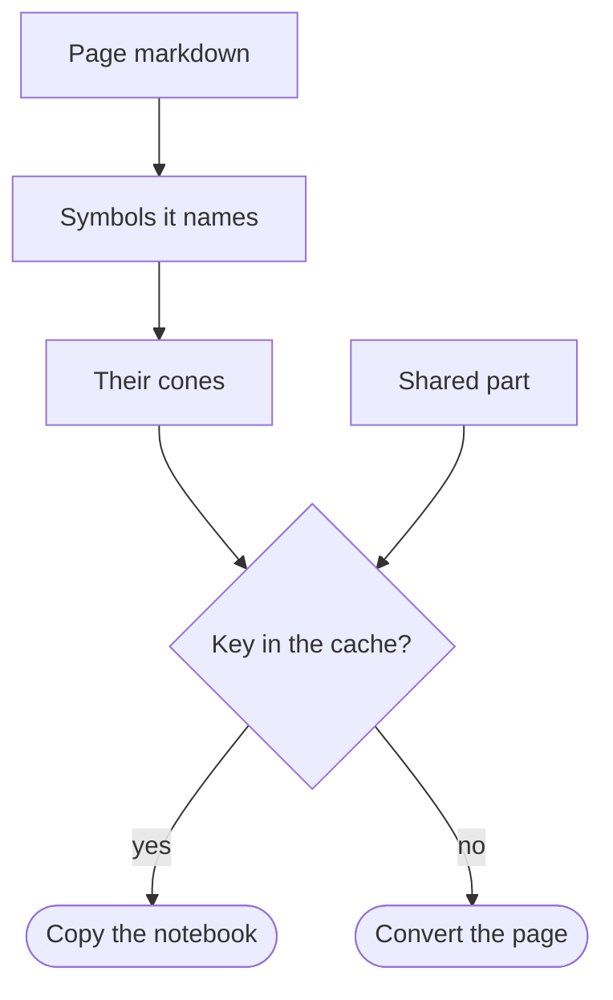

## What a build keeps

`BuildPacletDocumentation` converts each markdown page into a notebook and evaluates the page's examples. A large paclet has thousands of pages, and most changes touch a few of them. The build therefore keeps each page's notebook and each example's result, and converts a page again only when something the page depends on has changed.

A page depends on its own markdown, on the converter, and on the code its examples run. The build does not take that code to be the whole paclet. It reads the paclet's definitions and works out, for each page, which of them the page can reach.

What decides whether a page is converted again:



## A paclet with two functions

A copy of the small example paclet that comes with PacletPage:

```wl
dir = CopyDirectory[PacletObject["WolframInstitute/PacletPage"]["AssetLocation", "Example"], FileNameJoin[{$TemporaryDirectory, CreateUUID["Greetings-"]}]]
```

Its code has two functions. `Greet` calls a private helper, `mark`, and `Wave` stands alone:

```wl
ReadString[FileNameJoin[{dir, "Kernel", "Greetings.wl"}]]
```

Each function has a page, and a guide lists them:

```wl
FileNameTake[#, -2] & /@ FileNames["*.md", FileNameJoin[{dir, "docs"}], Infinity]
```

The page of `Wave`, with one example:

```wl
ReadString[FileNameJoin[{dir, "docs", "Symbols", "Wave.md"}]]
```

## The first build and the next

The first build converts every page and evaluates every example:

```wl
first = BuildPacletDocumentation[dir, "Parallel" -> False]
```

The pages it converted:

```wl
FileBaseName /@ first["Converted"]
```

Nothing has changed, so a second build copies every page from the cache:

```wl
second = BuildPacletDocumentation[dir, "Parallel" -> False]
```

```wl
FileBaseName /@ second["Cached"]
```

## A change to one function

`Wave` gets a new definition: it waves to a name, where it waved at one.

```wl
file = FileNameJoin[{dir, "Kernel", "Greetings.wl"}];
Export[file, StringReplace[ReadString[file], "waves at \"" -> "waves to \""], "Text"]
```

The code now:

```wl
ReadString[file]
```

The build converts the page that uses `Wave` and leaves the page of `Greet` as it is. The guide and the definition page name `Wave` too, so they are converted with it:

```wl
third = BuildPacletDocumentation[dir, "Parallel" -> False]
```

```wl
FileBaseName /@ third["Converted"]
```

A change to the private `mark` would do the opposite. No page names `mark`, but `Greet` calls it, so the pages that use `Greet` reach it.

## How a page's key is made

Before it converts anything, the build starts a fresh kernel that loads the paclet and reads every symbol's whole definition: its values of every kind, its options, its attributes and its messages. `PacletDefinitionScan` gives that scan:

```wl
scan = PacletDefinitionScan[dir]
```

Each symbol with a definition has a fingerprint of that definition:

```wl
scan["Symbols"]
```

A symbol uses the symbols its code names. `Greet` uses the private `mark`, and `Wave` uses nothing:

```wl
Graph[scan["Graph"], VertexLabels -> "Name"]
```

Everything a symbol uses, and everything those use in turn, is its cone, and each cone has one digest. A change anywhere in a cone changes the digest:

```wl
scan["Cones"]
```

A page uses the symbols its markdown names. `PacletPageDependencies` gives them, with every symbol they reach and the code that goes into the page's key:

```wl
PacletPageDependencies[dir, FileNameJoin[{dir, "docs", "Symbols", "Greet.md"}]]
```

The page of `Wave` reaches `Wave` alone, so the change to `Wave` converted it and no other:

```wl
PacletPageDependencies[dir, FileNameJoin[{dir, "docs", "Symbols", "Wave.md"}]]["Reached"]
```

The code holds the digests of the named symbols' cones and what every page shares: the paclet's `PacletInfo.wl`, the converter, the files the loading did not read and no code names, and the definitions of ``System` `` symbols that the paclet's own loading changed.

- A name in a string counts when it can be a symbol's name. A string with its context, such as `` "Demo`Greetings`Wave" ``, names that symbol. A bare name names a symbol of the same paclet, or a symbol in a context that the code, or code it calls, holds as a string, as a helper that joins a context to a name for `Symbol` does.
- A symbol's messages are part of its fingerprint, but the names in them are not uses.
- A `ReadProtected` definition is read all the same. A `Locked` one cannot be read, and stands for every file the loading read.

## Dependencies

The scan also loads the paclets the paclet depends on, and the ones those depend on, including a dependency the paclet loads only when a function first needs it. Their symbols are part of the cones. A new release of a dependency therefore converts the pages that reach what it changed, and a new version number alone converts nothing.

A dependency that does not load in the scanning kernel is in every page's key whole, so that any change to it converts every page. So is a dependency that an installed newer version outranks, which the build reports with a message.

## Files that no definition shows

Some of what a function does is not in its definition: a table it imports when it runs, a saved environment, a compiled library. The scan records which files the loading read, its `"FilesRead"`. A file it did not read, under `Kernel/`, `Assets/` or a root that the `PacletInfo.wl` declares, counts for the symbols whose code names it: by a directory on its path, its name, its name without extension or its asset name. A file that no code names counts for every page of the paclet, or, in a dependency, for every page that reaches the dependency.

`"CacheExcludedFiles"` leaves files out of the keys altogether, for files whose changes never show in a page.

## Example results

The converter keeps each example's result under the code of its cell and of the cells before it that it runs after. The build keeps those results in the cache directory too, and records which definitions each one was evaluated against:

```wl
FileNames["*", FileNameJoin[{dir, "build", "cache"}]]
```

Before it converts a page, the build deletes the results whose cells reach a changed definition. A page whose markdown changed but whose examples reach nothing new is converted without evaluating anything. A page with one result missing has all of its examples evaluated, since an example may use what an earlier one defined.

The pages whose examples were evaluated in the third build:

```wl
FileBaseName /@ third["Evaluated"]
```

## On a build server

The whole cache is one directory, `build/cache`, or the one given as `"CacheDirectory"`. A build server that saves and restores it between runs gets the same cached pages as a local build.

- With `"Monitor" -> True` the scan prints a line at each step and the build prints its progress, so a server that stops a silent build sees it working.
- Where `WOLFRAM_CLOUD_USER` and `WOLFRAM_CLOUD_PASSWORD` are set on a server, the scanning kernel connects to the cloud as that account, since a dependency may reach the cloud as it loads.
- The scan is done again only when the paclet's or a dependency's files change.

## The whole code as the key

`"CacheKey" -> "Code"` keys every page by all of the paclet's and its dependencies' code, so any change converts every page. The build also falls back to it when the paclet has no primary context, when its examples run on another kernel, or when the scan fails:

```wl
BuildPacletDocumentation[dir, "Parallel" -> False, "CacheKey" -> "Code"]
```

`"UseCache" -> False` converts every page and evaluates every example whatever the keys say.

The copy is no longer needed:

```wl
DeleteDirectory[dir, DeleteContents -> True]
```
