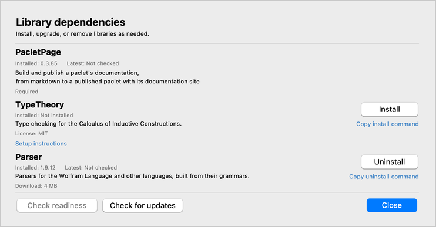
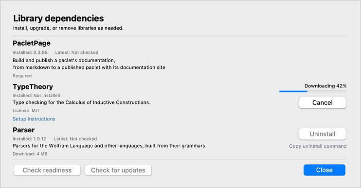
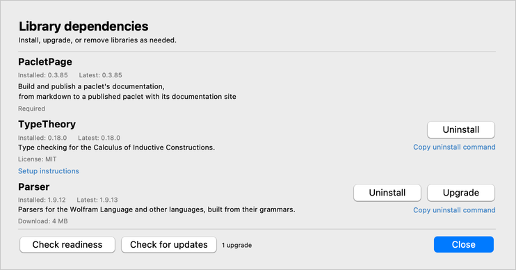
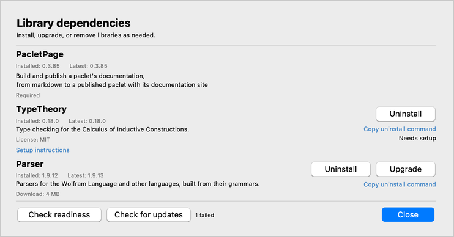
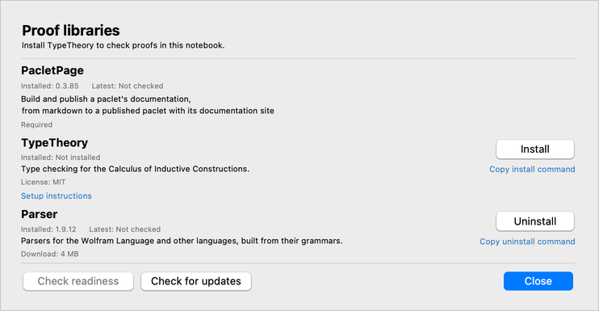
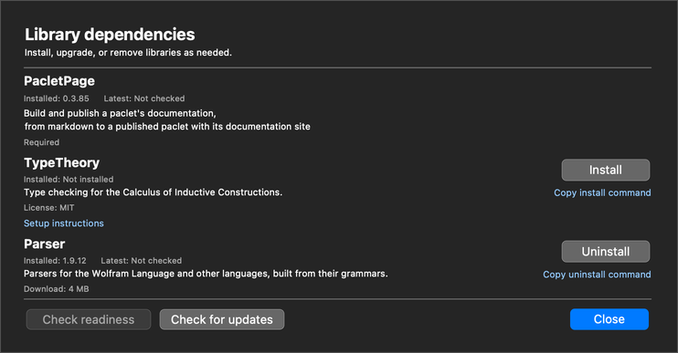

## Open the dialog

A paclet that declares the libraries it uses, a consumer, gives its users one window for them. Each library shows what it is, which version is installed and what can be done with it. This tutorial follows the consumer `Demo/Consumer` from the [Dependency Management](paclet:WolframInstitute/PacletPage/tutorial/DependencyManagement) tutorial. Its `"Dependencies"` list requires PacletPage and declares two libraries `"Optional" -> True`: TypeTheory, published as a Wolfram Cloud resource, and Wolfram/Parser, from a commit of its GitHub repository. The dialog lists them all, required and optional.

Open the dialog from a desktop notebook:

```wl
#| eval: false
PacletDependencyDialog["Demo/Consumer"]
```



The window's title is the consumer's short name and the heading, here **Consumer: Library dependencies**. The heading is **Library dependencies** when the consumer requires a library, and **Optional libraries** otherwise.

Each row is a library, in the order the consumer declares them:

- The library's short name, with its full name in a tooltip. Two libraries of the same short name show their full names.
- The installed version and, once looked up, the latest compatible one.
- The consumer's description of the library, or the installed library's own description.
- The download size, the license and links to setup instructions, where the consumer gives them.
- **Required** for a library the consumer cannot work without.

Opening the dialog reads only the local installation, so it opens without a network connection and reports **Not checked** for the latest versions. The buttons on the right are what a library allows now: **Install** for a missing library, and **Uninstall** for an installed optional one. A required library and PacletPage itself are never uninstalled from here.

## Install a library

Click **Install** beside TypeTheory. The row shows the transfer in place of its buttons: **Preparing**, **Checking release**, then the download, with a percentage when the publisher gives the archive's size. **Cancel** stops the transfer, and the library keeps the version it had, so the same window can try again. The other actions wait until the transfer ends.



When the transfer ends, the row reads the installation again and states what happened:

| Notice | Meaning |
|---|---|
| **Installed**, **Updated**, **Removed** | The action succeeded and the installed version is the one shown |
| **Restart required** | A version of the library was already loaded in this kernel; restart it to use the new one |
| **Needs setup** | The library is installed, but the consumer's readiness check failed |
| **Cancelled** | The transfer stopped and nothing changed |
| **Failed**, **Unconfirmed** | The action did not succeed, or its result could not be read back |

Hover over a notice to read its details.

## Check for updates

**Check for updates** looks up the latest compatible release of each installed library. While it runs, the button becomes **Cancel check** and the footer names the library being checked. A cancelled check stops after the current library and keeps the results it has.



A library with a newer release gets **Upgrade** beside its other button, and the footer sums up the check, here **1 upgrade**. A release that cannot be looked up reads **Unavailable**, and the check goes on to the next library. With Wolfram internet access disabled, cloud releases read **Offline**, and the dialog says how to enable it in place of its description.

## Check that libraries work

Installing a library is not always enough: a proof engine may need a toolchain, or a link a license. A consumer can declare a readiness check for a library, a function that tells whether the library works in this kernel. **Check readiness** runs the checks of the installed libraries, and becomes available once such a library is installed.



A library whose check fails shows **Needs setup**, and the footer counts the libraries that passed and failed. Hover over the notice for the reason, here "The readiness check `` Demo`Consumer`TypeTheoryReadyQ `` did not succeed." A check can return a `Failure` with its own message, such as what to install next. Installing a library runs its check too.

## Copy a command instead

The link under a row's buttons copies the command for that action, so that it can run in another notebook or a script:

```wl
#| eval: false
InstallPacletDependencies["Demo/Consumer", "WolframInstitute/TypeTheory"]
```

The link reads **Copied** until the next action. When the dialog's window is selected again, it reads the installation again, so a library installed or removed elsewhere shows its new state.

## Say what the libraries are for

A notebook can open the dialog with its own heading and introduction, to say in its own words what the libraries are for. The dialog still lists every dependency. The title is also the window's title, here **Consumer: Proof libraries**.

```wl
#| eval: false
PacletDependencyDialog["Demo/Consumer",
    "Title" -> "Proof libraries",
    "Description" -> "Install TypeTheory to check proofs in this notebook."]
```



`"Description" -> ""` leaves out the introduction. Opening the dialog again for the same consumer brings its window forward, with the title and description of the new call.

## Light and dark

The dialog takes the light or dark appearance of the notebook that opens it, and its notebook theme where the front end has themes. Opened from a dark notebook, it is dark:



Opening it again from another notebook gives it that notebook's appearance.

## Remind users at startup

A consumer can remind its users of missing optional libraries when it loads in a desktop notebook:

```wl
#| eval: false
PacletDependencyDialog["Demo/Consumer", "Notify"]
```

It prints a message that names the command to open the dialog, and only while an optional library is missing. Closing the dialog once turns the reminder off for that consumer. The reminder stays silent in scripts, batch kernels and continuous integration, which can call `PacletDependencyInformation` and the install, update and uninstall functions directly.
